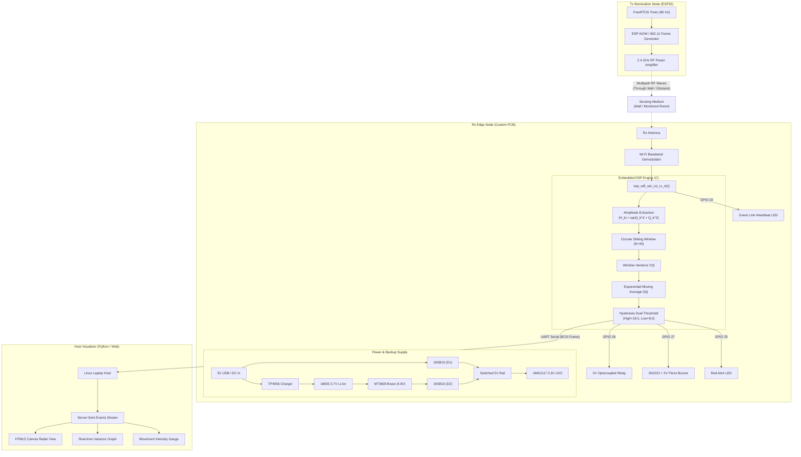

# System Architecture & Technical Diagrams

## 1. Top-Level Hardware & Software Architecture

---

## 2. Mathematical Signal Processing Formulation

### 2.1 Subcarrier Amplitude Extraction
For each received packet on Channel 6, the Wi-Fi baseband provides a complex CSI vector $H$:
$$H_k = I_k + j Q_k \quad (k \in [0, N_{sub}-1])$$
The amplitude of subcarrier $k$ is calculated as:
$$A_k = \sqrt{I_k^2 + Q_k^2}$$
The mean amplitude across subcarriers for packet $t$ is:
$$\bar{A}(t) = \frac{1}{K} \sum_{k=1}^K A_k$$

### 2.2 Sliding Window Variance
A circular FIFO buffer maintains the last $N = 40$ mean amplitude samples:
$$\mu(t) = \frac{1}{N} \sum_{i=0}^{N-1} \bar{A}(t - i)$$
$$V(t) = \frac{1}{N} \sum_{i=0}^{N-1} \left( \bar{A}(t - i) - \mu(t) \right)^2$$

### 2.3 Exponential Moving Average (EMA)
To eliminate spurious impulse noise without introducing phase delay:
$$S(t) = \alpha \cdot V(t) + (1 - \alpha) \cdot S(t - 1) \quad (\alpha = 0.25)$$

### 2.4 Hysteresis Dual-Threshold Decision Rule
Let $T_{\text{high}} = 18.5$, $T_{\text{low}} = 8.0$, and holdoff time $\tau_{\text{hold}} = 1.5\,\text{s}$:
$$\text{State}(t) = \begin{cases} 
\text{TRUE (Movement)}, & \text{if } S(t) \ge T_{\text{high}} \\
\text{TRUE (Hold)}, & \text{if } S(t) > T_{\text{low}} \text{ and } (t - t_{\text{trigger}}) < \tau_{\text{hold}} \\
\text{FALSE (Quiet)}, & \text{if } S(t) < T_{\text{low}} \text{ and } (t - t_{\text{trigger}}) \ge \tau_{\text{hold}}
\end{cases}$$
